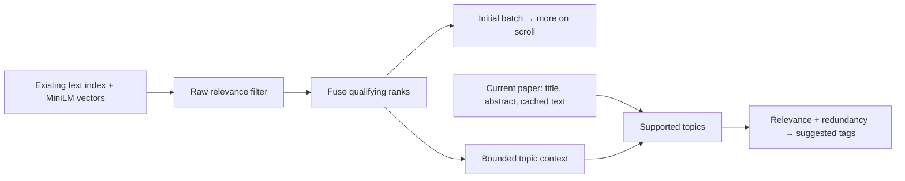
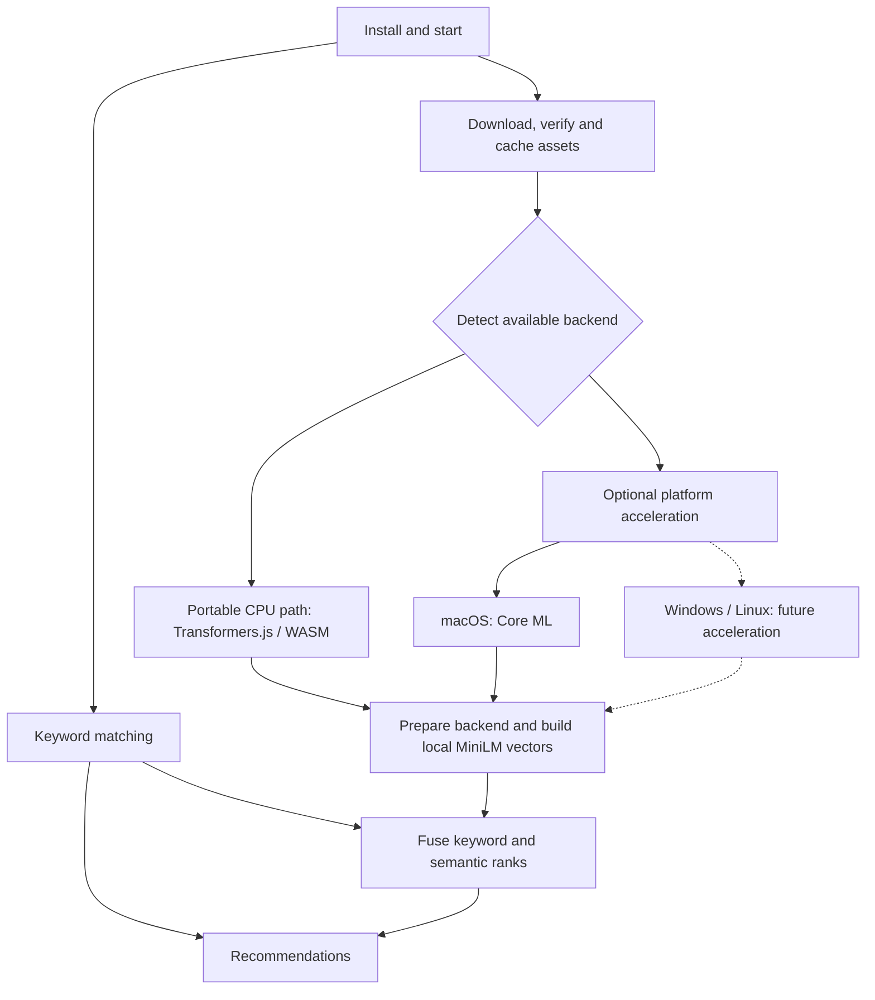

# Related Work


**English** | [简体中文](README.zh-CN.md)

Find similar papers in your Zotero library. Text processing stays on your computer.

## Install

Requires Zotero 10. Download the XPI from [Releases](https://github.com/lzcn/zotero-related-work/releases/latest), install it through **Tools → Plugins → Install Plugin From File**, and restart Zotero.

## Use

<!-- - Expand **Match evidence** under a result to compare shared terms and verbatim passages from both papers. Evidence uses titles, abstracts and existing cached text. -->

- Select a paper and open **Related Work** in the sidebar. Click a result to navigate; **From** returns to the previous paper.
- Review **Suggested tags**, with new tags first, then click **Add selected**. Topics need evidence in the current paper; the list stops when further suggestions add little value.
- Open **Tools → Tag Manager** to merge, rename, format or remove tags. Review changes before applying.

Settings control tag naming and protected tags. Recommendations combine text matching with local semantic matching on macOS. First use downloads about 90 MB of model weights, tokenizer files and a roughly 52 MiB macOS runtime archive; text results remain available during preparation and on other platforms. Semantic matching mainly supports English papers. The similarity graph is currently unavailable.

The interface uses a fixed Bear-inspired palette with compact recommendation lists and tag tables. Colors follow the system’s light or dark appearance; Settings use Zotero’s native controls.

## Data

Rebuildable caches live under `related-work/` in the Zotero data directory. The plugin leaves Zotero's original full-text database unchanged. Tag operations update native Zotero tags.

## Relevance and display

When a saved recommendation list is available, it appears before the full search index and document vectors finish loading. Background checks and reranking then update it; usable cached rows remain visible if loading fails.

The result count controls the initial batch, not a quota. Raw text and semantic scores filter weak matches before rank fusion; scrolling loads more qualifying papers (up to 100 retrieval candidates). A short list is never padded to the configured count.

Tags use the title, abstract and at most 24 KB of the selected paper's existing Zotero full-text cache. The sample is reused until the indexed source changes; missing text does not trigger OCR or a library scan. Repeated, distributed full-text phrases can introduce new topics; references and isolated mentions cannot. Existing indexed term counts verify body evidence. Neighbor support and MiniLM rerank supported topics, then relevance and phrase overlap determine where to stop. New and existing tags follow the same selection rule, without reserved slots. Tag inputs are independent of the displayed result count.



## Recommendation architecture

The following describes the target design. Implementation status is listed below.

Keyword matching works immediately without a model. After startup, the plugin automatically downloads and verifies the required assets, prepares the local backend and builds document vectors. Once vectors are available, recommendations combine keyword and semantic ranks using RRF. Text results remain available while semantic preparation is pending or unavailable. No Semantic switch is required.



The portable path uses Transformers.js with ONNX Runtime Web/WASM. An available platform backend is selected automatically; otherwise the portable path is used. Each platform can add acceleration; macOS is the first implementation. All backends retain all-MiniLM-L6-v2 and the same tokenization, text chunks, pooling and ranking rules. Backend changes require comparison of vectors and recommendation ranks.

Assets are separated by where they belong:

| Location          | Target contents                                                        |
| ----------------- | ---------------------------------------------------------------------- |
| XPI               | Plugin code, interface, licenses and small platform helpers            |
| Download cache    | Model weights, tokenizer files and required third-party runtime assets |
| Operating system  | Available system inference frameworks, such as Core ML on macOS        |
| Local build cache | Backend-specific compiled model caches and document vector indexes     |

The plugin manages setup automatically. Local preparation means initializing the backend and compiling model caches where needed, then building document vectors. Users do not need Node.js, Python, Xcode or a manual compilation step. Startup checks each paper once, reuses persisted source checks and only paces actual content updates. Valid downloaded files and unchanged document vectors are reused across restarts and plugin updates; assets are downloaded again when missing, damaged or changed by a required version update.

**Current implementation:** macOS uses native ONNX Runtime with Core ML acceleration and a CPU fallback; the JS Worker handles tokenization. Windows and Linux currently provide text recommendations. On macOS, semantic indexing starts automatically after a startup delay or when recommendations are opened, and missing model files are downloaded when inference first initializes. Model weights and the macOS ONNX Runtime library are downloaded separately with pinned SHA-256 checks; the XPI contains only the small native helper and runtime download metadata. Valid runtime caches are reused, missing or damaged libraries are downloaded again, and temporary downloads are removed after preparation or cancellation. The portable JS/WASM inference path and direct Core ML backend remain to be implemented. Windows and Linux acceleration backends are future work.

## Development

Use Node.js 22.13+ (22.x) or 24+.

```sh
npm ci
npm run check
npm run build
```

Output: `dist/zotero-related-work.xpi`. `npm run test:host` uses disposable Zotero directories. `npm run release` prepares local files under `release/v<version>/` without uploading.

Inference shares one algorithm for tokenization, chunking, pooling and ranking. `inference-backend.h` owns ONNX execution and CPU fallback; `coreml-backend.h` supplies the macOS provider. Core ML initialization or execution failure falls back to the CPU backend. Native packaging currently supports macOS; other platform adapters are not implemented. `SW_NATIVE_MODEL_DIR=/path/to/model node scripts/test-native.mjs` checks CPU/Core ML vector and rank agreement using temporary caches.

`node scripts/benchmark-search.mjs` measures deterministic index rebuilding, signature decoding and retrieval without using a personal library. It reports a ranking digest for before/after comparisons; timings exclude Zotero storage and native model inference.

## License

Copyright © 2026 Zhi Lu. [AGPL-3.0-or-later](LICENSE). Code developed with ChatGPT and DeepSeek.
