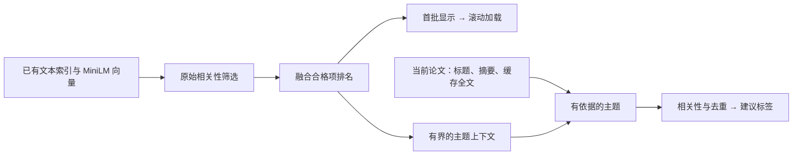
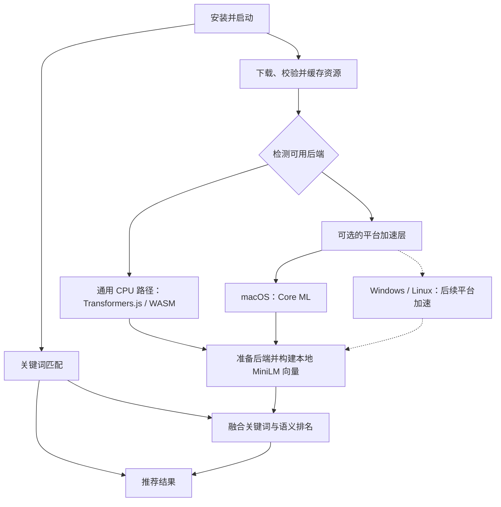

# Related Work


[English](README.md) | **简体中文**

在 Zotero 文献库中查找相似文献，文本处理在本机完成。

## 安装

需要 Zotero 10。从 [Releases](https://github.com/lzcn/zotero-related-work/releases/latest) 下载 XPI，通过 **工具 → 插件 → 从文件安装插件** 安装，然后重启 Zotero。

## 使用

<!-- - 展开推荐结果下的**匹配依据**，对照共同词语和两篇论文的原文片段；依据来自标题、摘要及已有正文缓存。 -->

- 选择文献，展开侧栏中的 **相关研究**。点击结果跳转，点击 **来自** 返回上一篇文献。
- 核对**建议标签**，新标签在前，再点击**添加所选**。主题须有当前论文的依据，新增建议价值不足时停止。
- 打开 **工具 → 标签管理**，合并、重命名、统一格式或移除标签，核对后应用。

在设置中调整标签命名和受保护标签。推荐结合文本匹配与 macOS 本地语义匹配。首次使用下载约 90 MB 模型权重、分词文件及约 52 MiB 的 macOS 运行库压缩包；准备期间和其他平台仍提供文本结果。语义匹配主要适合英文文献，相似度关系图暂不开放。

界面以 Bear 配色为基础，采用固定样式，推荐列表和标签表格保持紧凑。颜色跟随系统的浅色或深色外观；设置页使用 Zotero 原生控件。

## 数据

可重建缓存位于 Zotero 数据目录的 `related-work/`，原始全文数据库保持不变。标签操作会修改 Zotero 原生标签。

## 相关性与展示

有推荐缓存时，先显示上次结果，再在后台完成检索索引与文献向量的加载、检查和重新排序；后台加载失败时仍保留可用的缓存结果。

显示数量控制首批条数，不是推荐配额。文本与语义原始分数先排除弱相关项，再融合排名；滚动时继续加载合格文献（检索候选最多 100 篇）。相关项少时不会凑满设置的数量。

标签使用当前论文的标题、摘要和最多 24 KB 的 Zotero 已有全文缓存。索引来源变化前复用文本样本；全文缺失时不触发 OCR 或扫描文献库。全文中分散、反复出现的短语可以带来新主题，参考文献和单次提及不能作为依据，并使用已有索引词频核对全文证据。邻近文献和 MiniLM 只为有依据的主题排序，再按相关性和短语重复程度决定何时停止。新旧标签使用相同的筛选规则，不预留名额；标签输入不受文献显示数量影响。



## 推荐架构

以下为目标设计，当前实现状态见本节末尾。

关键词匹配无需模型，安装后即可使用。启动后，插件自动下载并校验所需资源，准备本地推理后端，再构建文献向量。向量可用后，通过 RRF 融合关键词与语义排名；语义资源尚未准备好或不可用时，继续提供文本结果。无需增加 Semantic 开关。



通用路径采用 Transformers.js 与 ONNX Runtime Web/WASM。自动选用可用的平台后端，否则使用通用路径。各平台均可增加加速后端，macOS 是首个实现。所有后端保留 all-MiniLM-L6-v2，以及相同的分词、文本分块、向量聚合和排名规则；更换后端时，需要对比向量和推荐排名。

资源按归属分开管理：

| 位置         | 目标内容                                  |
| ------------ | ----------------------------------------- |
| XPI          | 插件代码、界面、许可证和小型平台辅助程序  |
| 下载缓存     | 模型权重、分词文件及所需的第三方运行资源  |
| 操作系统     | 可用的系统推理框架，例如 macOS 的 Core ML |
| 本地构建缓存 | 后端所需的模型编译缓存，以及文献向量索引  |

资源准备由插件自动完成。本地准备包括初始化后端、在需要时编译模型缓存，然后构建文献向量；用户无需安装 Node.js、Python、Xcode 或手动编译。启动时每篇论文只核对一次，复用已保存的来源状态，仅对内容更新进行限速。重启和更新插件时，复用校验通过的下载文件与未变化文献的向量；文件缺失、损坏或所需版本变化时才重新下载。

**当前实现：** macOS 使用原生 ONNX Runtime，尝试 Core ML 加速，失败时使用 CPU；JS Worker 负责分词。Windows 和 Linux 目前提供文本推荐。macOS 在启动延迟后或打开推荐时自动启动语义索引，首次初始化推理时下载缺失的模型文件。模型权重与 macOS 的 ONNX Runtime 库均单独下载，并校验固定的 SHA-256；XPI 仅包含小型原生辅助程序和运行库下载清单。有效运行库缓存直接复用，缺失或损坏时重新下载；准备完成或取消后清理临时下载文件。通用 JS/WASM 推理与直接调用 Core ML 尚待实现；Windows 和 Linux 的加速后端属于后续工作。

## 开发

需要 Node.js 22.13+（22.x）或 24+。

```sh
npm ci
npm run check
npm run build
```

产物：`dist/zotero-related-work.xpi`。`npm run test:host` 使用临时 Zotero 目录；`npm run release` 在 `release/v<版本>/` 准备本地文件，不上传。

推理共用分词、切块、聚合和排序算法。`inference-backend.h` 负责 ONNX 执行与 CPU 回退，`coreml-backend.h` 提供 macOS 后端；Core ML 初始化或执行失败会回退到 CPU。目前原生打包支持 macOS，其他平台适配尚未实现。`SW_NATIVE_MODEL_DIR=/path/to/model node scripts/test-native.mjs` 使用临时缓存核对 CPU 与 Core ML 的向量和排序一致性。

`node scripts/benchmark-search.mjs` 使用固定合成数据测量索引重建、指纹解码和检索，不读取个人文献库。排序摘要用于核对优化前后的结果；耗时不包含 Zotero 存储和原生模型推理。

## 许可证

Copyright © 2026 Zhi Lu. [AGPL-3.0-or-later](LICENSE)。代码借助 ChatGPT 和 DeepSeek 开发。
