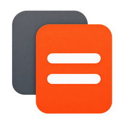

# Related Work

 

本项目的代码几乎全部由 ChatGPT 和 DeepSeek 生成。

[English](README.md) | **简体中文**

在 Zotero 中复用已有全文缓存，查找同一文献库中的相似文献。文本处理在本机完成。

## 安装

需要 Zotero 10。从[最新发布](https://github.com/lzcn/zotero-related-work/releases/latest)下载 XPI，通过 **工具 → 插件 → 从文件安装插件** 安装，然后重启 Zotero。

确认退出 Zotero 时取消索引、下载和 Worker 请求，等待本地推理进程结束，再完成已有缓存读取并关闭索引数据库。

## 使用

选择文献并展开侧栏中的 **相关研究**。点击刷新重新计算推荐，点击结果选中文献并保持相关研究面板展开。高亮的 **来自** 卡片可返回上一步文献，即使该文献不在推荐列表中。后台索引及条目修改会更新缓存；索引完成前，推荐结果可能不完整。

相似度关系图仍在开发中，暂不开放。

**建议标签** 综合标题、摘要中的短语和相似文献的标签，最多显示 12 个建议，其中最多 4 个 **新标签**。本地模型可调整排序。选择后点击 **添加所选**；不会自动添加。

通过 **工具 → 标签管理** 搜索标签，点击 **名称**、**条目数** 或 **匹配** 表头排序。**可能重复** 包括名称变体、单复数、常见术语别名、带明确全称的缩写和轻微拼写差异，显示匹配组及依据供核对；不同主题和模型版本保持区分。全选作用于筛选结果，计数包含隐藏的已选标签。

**合并** 将两个及以上标签合为指定名称；**重命名** 修改一个标签；**统一格式** 分别格式化所选名称并预览重名合并；**删除** 从条目中移除标签，保留文献和笔记。核对影响条目数后执行，修改使用 Zotero 原生标签接口。

标签名称固定使用空格。在设置中选择 **句首大写**（默认）或 **每词首字母大写**，并单独选择是否加 `#`。已知模型名保留标准写法；现有缩写、`PyTorch` 这类混合大小写名称及 `co-attention` 这类词内连字符也会保留。本地 `data/tag-terms.json` 词表结合 Hugging Face Transformers 的模型名称与项目维护的研究术语，随插件打包，名称格式化不需要联网。有颜色的标签默认受保护；其他名称在 **排除标签** 中填写，每行一个，其同类写法也受保护。

推荐自动结合文本与本地语义匹配，匹配参数和所需文件由内部管理。在 macOS 上，首次使用从 Hugging Face 下载约 90 MB 文件，失败时使用 hf-mirror.com。语义匹配主要适合英文文献。文件准备或处理失败期间，以及其他平台上，仍提供文本结果。排序不显示为相似度百分比。

后台语义索引等待空闲时段，选中文献优先处理。分词在 Worker 中完成，推理按文本逐项执行。在 macOS 13.3 及以上版本，内置的通用原生辅助程序使用 ONNX Runtime 和 Core ML；初始化或推理失败时回退原生 CPU。Apple 选择可支持的硬件，不保证使用 Neural Engine。辅助程序以低优先级运行，暂停语义索引或退出 Zotero 时终止。缓存向量分小批、可取消地加载，让启动过程及时让出界面线程。

macOS 标签管理器使用 Command-A/F/W 全选、搜索和关闭。搜索等待输入法组合结束，并短暂合并连续输入；减少动态效果设置会关闭界面过渡动画。

设置页显示准备进度与已处理文献数量，不显示具体模型名、维数或构建哈希。所需文件自动管理，文献内容始终在本机处理。

## 数据与备份

可重建文件统一位于 Zotero 数据目录的 `related-work/`：`similarity.sqlite` 保存指纹、向量和排序，`index-status.json` 记录进度，`model/` 和 `runtime/` 保存推理文件。未变化的文献直接复用缓存向量。插件不修改 Zotero 原始全文数据库。

只支持当前存储格式。遇到其他数据库版本时拒绝打开且不改写，不导入旧目录、旧偏好或旧模型格式。现有文献、笔记和标签保留。

## 开发

### 匹配实现

- **文本**（`src/search.js`）：BM25F 式字段加权（标题／摘要／正文 = 4/2/1）、256 特征稀疏指纹、Block-Max WAND 候选检索与余弦排序。
  - **语义**（`src/semantic.js`、`ml/worker.js`、`native/inference.mm`）：`Xenova/all-MiniLM-L6-v2`，FP32 ONNX、384 维；按 120 词分块，词元均值池化后再归一化合并，首块权重为 3。在当前文献库内精确扫描余弦相似度。模型 revision 和文件校验值固定在 `src/semantic.js`；ONNX Runtime 1.22.0 使用 Core ML，失败时回退原生 CPU。
- **默认排序**：等权 RRF（常数 60，每路前 100 个结果）。向量不可用时仍使用文本检索，参数不向用户开放。

需要 Node.js 22.13+（22.x）或 24+。依次运行 `npm ci`、`npm run check`。

- `npm run build`：输入未变化时复用有效产物。在上级工作区运行 `make` 可统一构建三个插件。
- `npm run clean`：清理构建产物，保留已下载工具、依赖、研究数据和发布文件。
- `npm run build:force`：强制重建。
- `npm run check`：格式、静态检查、测试和类型检查；复用有效 XPI。
- `npm run release`：完整检查后，在 `release/v<版本>/` 准备 XPI、`SHA256SUMS` 和 `updates.json`。

`npm run test:host` 使用临时配置和数据目录验证启动、文本与语义推荐、手动标签管理、设置与退出，通过 `ZOTERO_BINARY` 指定宿主程序。

构建产物：`dist/zotero-related-work.xpi`。安装后在 Zotero 中验证改动。本地发布准备不创建 tag 或上传文件。共同开发规范见工作区根目录 `AGENTS.md`。

## 许可证

Copyright © 2026 Zhi Lu. [AGPL-3.0-or-later](LICENSE)。第三方库保留各自许可证。
